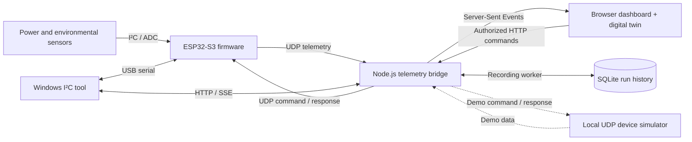
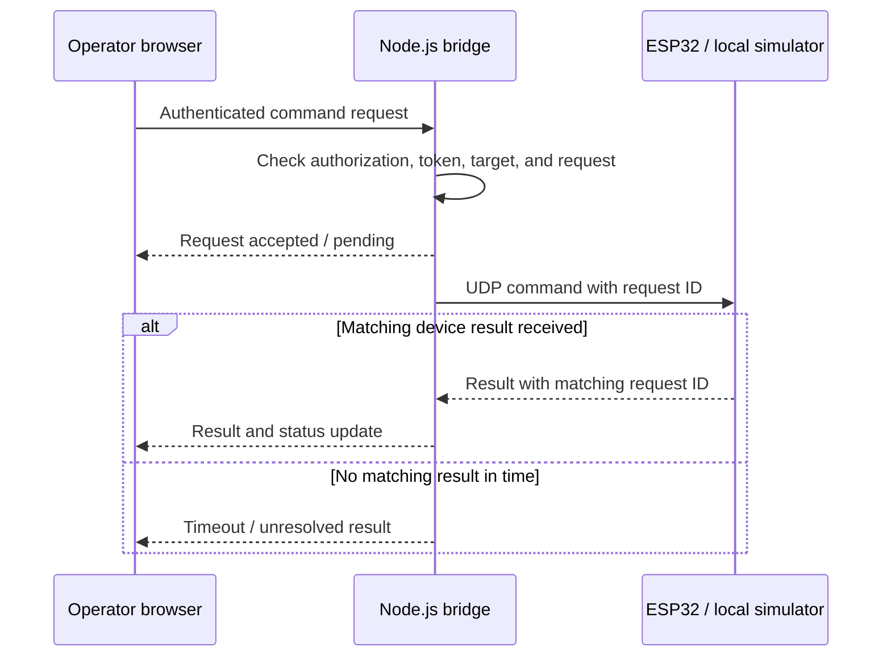

# Orbital Address

[](https://github.com/vtm5rdzv98-hub/Orbital-Address/actions/workflows/ci.yml)

**Real-time telemetry, diagnostics, and operator controls for the KnightEPS CubeSat electrical power system.**

Orbital Address is the ground-side software platform for **KnightEPS**, a University of Central Florida senior design project centered on a solar-assisted CubeSat electrical power system (EPS) prototype. It connects embedded power-system measurements to a web interface for monitoring, recording, troubleshooting, and authorized bench control.

**[Live website](https://orbitaladdress.com/#home)** · **[Dashboard](https://orbitaladdress.com/#dashboard)** · **[Project video](https://youtu.be/O13I94AdMXs)** · **[v1.0.0 release](https://github.com/vtm5rdzv98-hub/Orbital-Address/releases/tag/v1.0.0)** · **[Run the local demo](#run-locally)** · **[Explore the architecture](#architecture)**


*Screenshot from the local demonstration. The values are **simulated**, not measurements taken from the CubeSat hardware.*

## At a glance

| Layer | Technologies |
| --- | --- |
| Embedded interface | ESP32-S3, ESP-IDF, C, I²C, ADC, Wi-Fi |
| Telemetry and commands | UDP, versioned packets, HTTP, Server-Sent Events (SSE) |
| Backend | Node.js, JavaScript, SQLite, worker threads |
| Frontend | HTML, CSS, JavaScript, Three.js / WebGL |
| Operations | DigitalOcean, Ubuntu, Apache, Bash |
| Bench tooling | Python, PySide6, USB serial, wireless I²C tools |

### What the platform does

- **Live monitoring:** Displays PV, battery, charger, load, temperature, and light telemetry with subsystem-specific views and raw packet evidence.
- **Network diagnostics:** Surfaces link health, packet timing, and communication statistics to help diagnose an unreliable connection.
- **Recording and analysis:** Stores telemetry runs and associated events for inspection, replay, and CSV export.
- **Controlled hardware access:** Provides authenticated register inspection, I²C debugging, and command/response status for authorized operators.
- **Programmable bench workflows:** Supports saved branch definitions, conditional steps, local simulation, and reviewed execution against a connected device.
- **Interactive digital twin:** Provides a CAD-derived 3D view of the 6U prototype, with preset views and component-level inspection.

The platform is designed around a physical engineering prototype, **not a flight-qualified spacecraft or an orbital ground station**. The public site, local simulator, and connected-hardware workflows are different operating contexts.

## Run locally

The included demonstration runs the actual browser application and Node.js bridge, with a **local UDP device simulator** standing in for the ESP32. No CubeSat, DigitalOcean account, or production credentials are needed.

The demo launcher prepares the pinned Three.js r176 browser runtime on first use (`npm` registry access is required for that initial preparation).

**Requirements:** Node.js 22 or 24, npm, and Bash. On Windows, use a Bash-compatible environment.

```bash
git clone https://github.com/vtm5rdzv98-hub/Orbital-Address.git
cd Orbital-Address
npm ci --prefix telemetry-bridge
```

**Viewer demo** — explore monitoring, network statistics, and the digital twin:

```bash
bash tools/demo.sh
```

**Operator demo** — exercise the authenticated programming and sequence-execution paths against the simulator:

```bash
bash tools/demo.sh --operator
```

Open **http://127.0.0.1:8090**, select **Dashboard**, and sign in using the temporary credentials printed in the terminal. The operator launcher also prints a separate command token. Press **Ctrl+C** to stop the demo; the launcher removes its temporary local credentials and run history.

The operator demo uses real application authentication, command validation, execution review, UDP dispatch, and response correlation. **The target device and its register responses are simulated.** The services bind to loopback and do not connect to production hardware.

### A guided operator workflow

1. Open **Programming** and use **Bus Scan + Probe** to discover the simulated INA226, BQ76942, and BQ25798 devices.
2. Read the INA226 calibration register and inspect the returned value.
3. In **Branch Definition**, load the included *INA226 bench check*, simulate its condition, then review and confirm execution against the local UDP simulator.
4. Open **Logged Telemetry** to inspect the resulting events, acknowledgments, and captured samples.

[Step-by-step operator walkthrough](docs/operator-demo.md)

| Programming | Branch Definition |
| --- | --- |
|  |  |

## Architecture

Measurements originate from the ESP32-S3, which polls the power-management devices over I²C and samples analog peripherals. The firmware packages those readings for transport over Wi-Fi/UDP. The Node.js bridge receives and decodes packets, converts register fields to engineering values, publishes updates through SSE, and optionally records runs to SQLite.



The local demo and the connected ESP32 are alternative sources, not simultaneous requirements.

### Operator command lifecycle

The bridge treats **acceptance of a request** separately from **confirmation of a hardware result**. A command can be accepted for processing and still fail or time out at the device.



See [authentication and operator controls](telemetry-bridge/AUTHENTICATION.md), [protocol documentation](TELEMETRY_PACKET_V1.md), and [debug-mode behavior](DEBUG_MODE.md) for implementation details. Optional signed-telemetry verification is documented separately and should not be confused with transport encryption.

## Explore the implementation

| Area | Start here |
| --- | --- |
| UDP ingest, decoding, SSE, APIs, and command dispatch | [Node.js bridge](telemetry-bridge/server.js) |
| Telemetry and subsystem instrumentation UI | [Browser dashboard](site/assets/js/i2c.js) |
| CAD-derived 3D viewer and rendering decisions | [Digital twin rendering notes](site/knight-eps-phase12/docs/rendering.md) |
| Conditional workflows and command coordination | [Sequence engine](telemetry-bridge/sequence/engine.mjs) |
| Recorded runs, data model, and export | [Recording architecture](telemetry-bridge/RECORDING.md) |
| ESP-IDF setup, packet formats, and bench checks | [Firmware and hardware guide](docs/hardware.md) |
| Serial and wireless engineering utilities | [Windows I²C tool](cubesat-i2c-tool/README.md) |
| Roles, sessions, CSRF, and operator ownership | [Authentication guide](telemetry-bridge/AUTHENTICATION.md) |
| Optional message authenticity and replay checking | [Telemetry provenance](telemetry-bridge/TELEMETRY_PROVENANCE.md) |

## Testing and evidence

This repository includes automated tests for backend behaviors, link tooling, and the browser-side digital twin. From the repository root, run:

```bash
npm test --prefix telemetry-bridge
npm test --prefix tools/link-tools
node --test tests/twin/*.test.mjs
```

The suites cover areas including packet ingestion, session/role enforcement, recording, sequence execution, link statistics, and model/data behavior. The [hardware guide](docs/hardware.md) provides portable C test commands and an ESP-IDF build path; the [desktop tool guide](cubesat-i2c-tool/README.md) covers Python testing.

**What is demonstrated, and what is not:**

| Evidence | Scope |
| --- | --- |
| Local viewer/operator demo | Exercises the real UI, bridge, session and command paths using **synthetic telemetry and simulated device responses** |
| Automated software tests | Check documented software behaviors; they do not establish hardware measurement accuracy or production uptime |
| Physical EPS bench evaluation | Requires separate measurements and test conditions; covered in the team's engineering presentation, not reproduced by the simulator |
| 3D digital twin | Supports visual inspection of the prototype; its animations and components should not be interpreted as live physical-state measurement unless explicitly implemented and verified |

For the broader CubeSat design, hardware architecture, and team testing context, see the **[KnightEPS project presentation](https://youtu.be/O13I94AdMXs)**.

## Deployment and security

The project website uses an Apache-served frontend with a Node.js telemetry service. A local demonstration is intentionally independent of that deployment; a clone of this repository is **not proof of the exact revision currently running at orbitaladdress.com**.

For private or hardware-connected deployments:

- Use the [authentication guide](telemetry-bridge/AUTHENTICATION.md) to configure accounts, HTTPS origin, and command authorization.
- Keep passwords, command tokens, telemetry signing keys, and database files outside the public site and version control.
- Start with the blank firmware configuration described in the [hardware guide](docs/hardware.md); verify actual pin assignments and hardware before flashing.
- Treat remote register writes and automated sequences as privileged bench operations, not public-demo features.

## My role and project credits

I am **Itzjac Lechtman**, a Computer Engineering student at UCF. My work focused on **cloud infrastructure, backend telemetry integration, and the browser monitoring interface**—connecting embedded data to a deployed, understandable engineering tool. The portfolio presentation and local demonstration also include work from the broader KnightEPS team.

KnightEPS was developed collaboratively by UCF Senior Design Group 4:

| Contributor | Project responsibility |
| --- | --- |
| **Itzjac Lechtman** | Software, cloud infrastructure, and GUI |
| **Jaden Adkins** | Firmware, drivers, and MCU telemetry |
| **William Garland** | Power management, battery systems, and PCB design |
| **Liam Magee** | MCU hardware, voltage regulation, and PCB design |

These responsibilities describe the team's areas of work; the complete system is a collaborative result. The repository contains project hardware, firmware, software, and digital-twin assets and should not be interpreted as a claim of sole authorship.

## License and acknowledgments

Source code is provided under the repository's [Apache License 2.0](LICENSE). Respect upstream licensing and notices for [Three.js](site/knight-eps-phase12/viewer/vendor/three/LICENSE), [daisyUI](site/assets/vendor/LICENSE-daisyUI.txt), and [fonts](site/assets/fonts/LICENSES.txt). Project imagery and digital-twin assets were supplied by the KnightEPS team and may carry separate reuse considerations.

**[Visit Orbital Address](https://orbitaladdress.com/#home)** · **[Watch the project video](https://youtu.be/O13I94AdMXs)**
