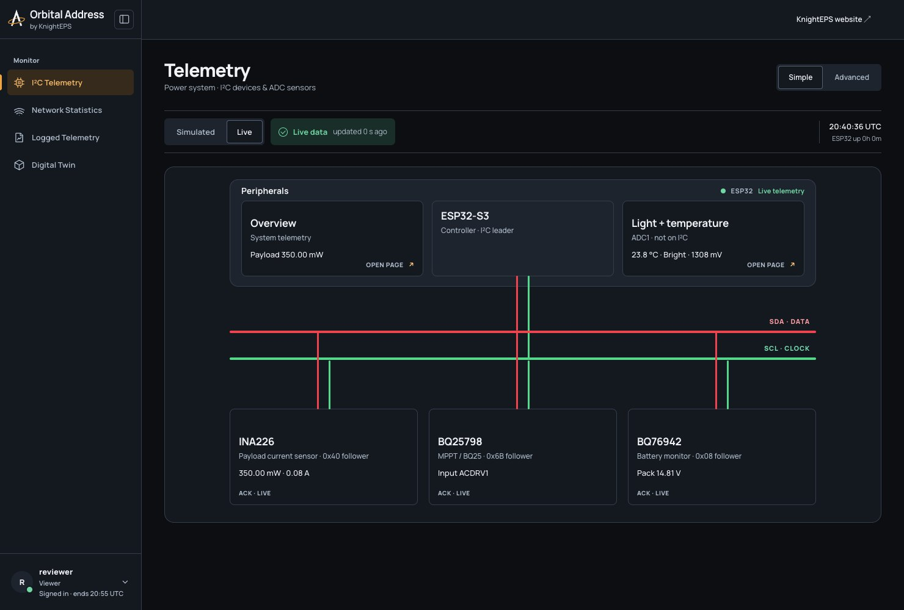
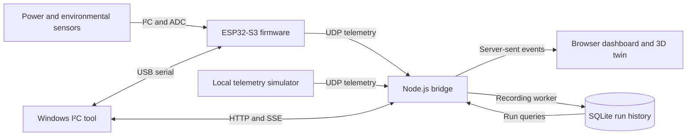

# Orbital Address

Orbital Address is the ground-side software for **KnightEPS**, a University of Central Florida senior design project that built and instrumented a CubeSat electrical power system prototype. The dashboard follows power, battery, and environmental measurements from the bench hardware through the network to a browser.

**My contribution.** I’m Itzjac Lechtman. I developed the cloud telemetry infrastructure and the browser monitoring interface, from receiving and processing ESP32 packets to displaying measurements, link quality, and recorded runs. Jaden Adkins worked on embedded firmware and telemetry, William Garland designed the power management and battery circuits, and Liam Magee developed the MCU hardware and voltage regulation.



*The bridge streams simulated device packets through the dashboard’s Live data path.*

## Run the demo

Use Node.js 22 or 24, npm, Bash, and curl. From the repository root:

```sh
npm ci --prefix telemetry-bridge
bash tools/demo.sh
```

Open [the local dashboard](http://127.0.0.1:8090), select **Dashboard**, and sign in with the `reviewer` username and the password printed in your terminal. These credentials expire when the demo stops. Press **Ctrl+C** to stop it.

- **I²C Telemetry** shows simulated solar input, battery cells, charger state, and environmental sensors.
- **Network Statistics** plots packet timing, loss, and link quality from the simulated UDP stream.
- **Digital Twin** lets you orbit, explode, and inspect the prototype in 3D, with a simulated telemetry display.
- **Logged Telemetry** shows the run browser. The viewer demo starts with an empty history.

The demo works without hardware or cloud credentials. It binds to loopback, uses the real viewer login, and feeds synthetic packets through the same bridge decoder as the firmware. Hardware commands require an operator session and separate credentials.

## System overview



The bridge decodes versioned packets, converts register values into engineering units, and streams telemetry with server-sent events. A dedicated SQLite worker keeps recording writes out of the UDP receive path. The browser and desktop clients share a sequence model for simulating and running bench procedures. The bridge owns execution and enforces the operator controls.

## Review the code

| Start here | What to look for |
| --- | --- |
| [Bridge entry point](telemetry-bridge/server.js) | UDP packet decoding, SSE, API routes, and command dispatch |
| [Browser dashboard](site/assets/js/i2c.js) | Live telemetry, register data, and instrumentation state |
| [Digital twin renderer](site/knight-eps-phase12/docs/rendering.md) | Three.js render modes, compressed geometry, and inspection |
| [Sequence engine](telemetry-bridge/sequence/engine.mjs) | Branches, conditions, simulation, and command coordination |
| [Recording design](telemetry-bridge/RECORDING.md) | Run boundaries, data retention, and export |
| [Firmware and bench setup](docs/hardware.md) | ESP-IDF setup, packet formats, and the INA226 bench target |
| [Windows desktop tool](cubesat-i2c-tool/README.md) | Serial and wireless I²C, mock mode, and the PySide6 client |
| [Authentication](telemetry-bridge/AUTHENTICATION.md) | Viewer and operator roles, session checks, CSRF, and the operator lease |
| [Signed telemetry](telemetry-bridge/TELEMETRY_PROVENANCE.md) | Optional HMAC authentication for firmware datagrams |

## Configuration and security

The [authentication guide](telemetry-bridge/AUTHENTICATION.md) explains how to generate a private account file and configure an HTTPS origin. Keep account files, command tokens, signing keys, and recordings outside the public site and Git. The [firmware templates](docs/hardware.md) provide blank credentials and a documentation-only network address.

## Tests

```sh
npm test --prefix telemetry-bridge
npm test --prefix tools/link-tools
node --test tests/twin/*.test.mjs
```

These cover UDP ingestion, session and role enforcement, recording, sequence execution, link statistics, and the browser-side data and model code. The [hardware guide](docs/hardware.md) lists portable C tests. The [desktop guide](cubesat-i2c-tool/README.md) covers Python tests and packaging.

See the [Apache 2.0 license](LICENSE) and upstream notices for [Three.js](site/knight-eps-phase12/viewer/vendor/three/LICENSE), [daisyUI](site/assets/vendor/LICENSE-daisyUI.txt), and [fonts](site/assets/fonts/LICENSES.txt). The KnightEPS team supplied the project imagery and digital twin assets.
