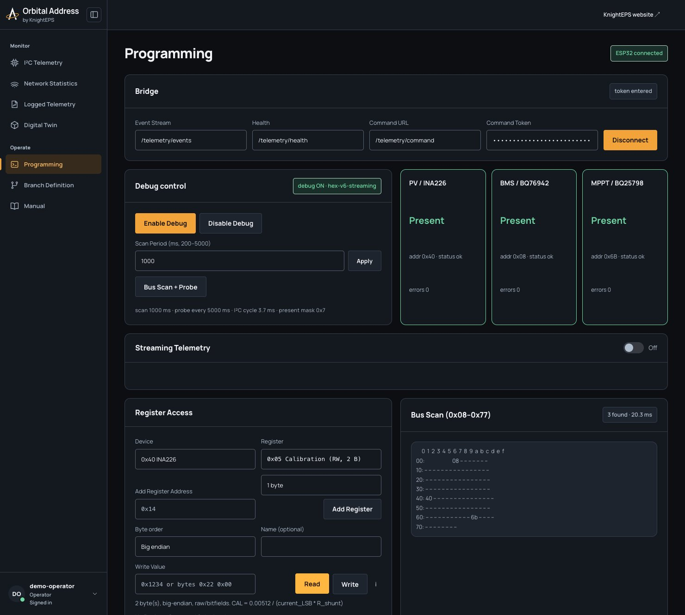
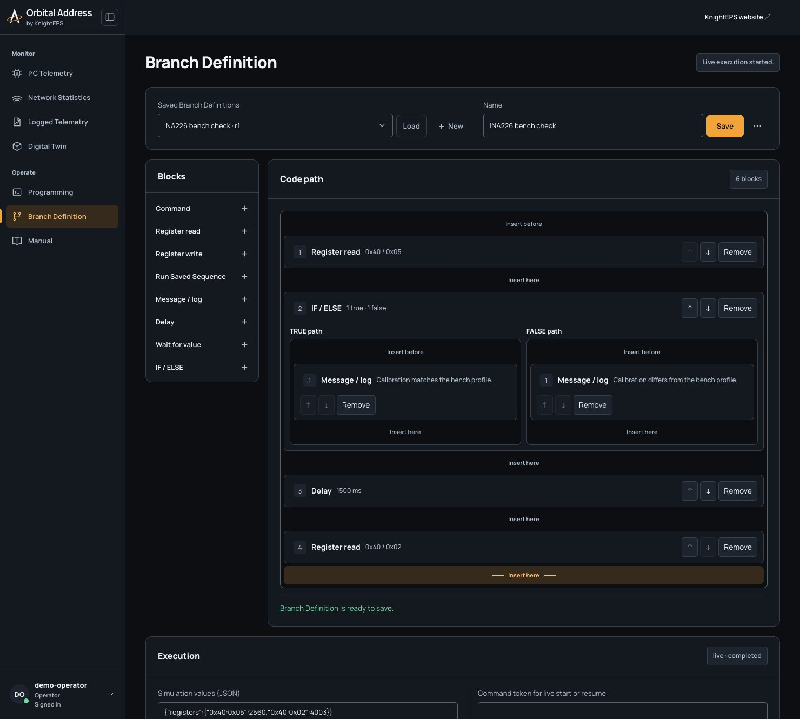

# Programming and sequence runs

From the repository root, install the bridge dependencies and start the operator demo:

```sh
npm ci --prefix telemetry-bridge
bash tools/demo.sh --operator
```

Open the local dashboard and sign in using the username and password printed in your terminal. The command token is a separate credential. Keep the launcher running while you explore. [Open the local dashboard](http://127.0.0.1:8090)

## Programming

1. Open **Programming** and paste the command token into **Command Token**.
2. Select **Bus Scan + Probe**. The simulator responds as the INA226, BQ76942, and BQ25798.
3. In **Register Access**, select **INA226**, choose **Calibration (0x05)**, and select **Read**. The simulated register returns `0x0A00`.



## Branch Definition

1. Open **Branch Definition**, select **INA226 bench check** from **Saved Branch Definitions**, then select **Load**. The definition reads the calibration register, branches on its value, waits briefly while telemetry streams, and reads bus voltage.
2. Paste the JSON below into **Simulation values (JSON)** and select **Simulate**. The event list shows the matching branch and its message.

   ```json
   {"registers":{"0x40:0x05":2560,"0x40:0x02":4003}}
   ```

3. Paste the command token into **Command token for live start or resume** and select **Review live execution**. The review names the device `portfolio-simulator` at `127.0.0.1:3341`. Select **Confirm live execution** to run through the real command and acknowledgment path using the simulator.
4. Open **Logged Telemetry** to inspect the completed run, its branch events, and the linked telemetry recording. Both executions appear in sequence history. The simulated execution uses the supplied JSON and the live-mode execution creates a recording from the UDP simulator.


